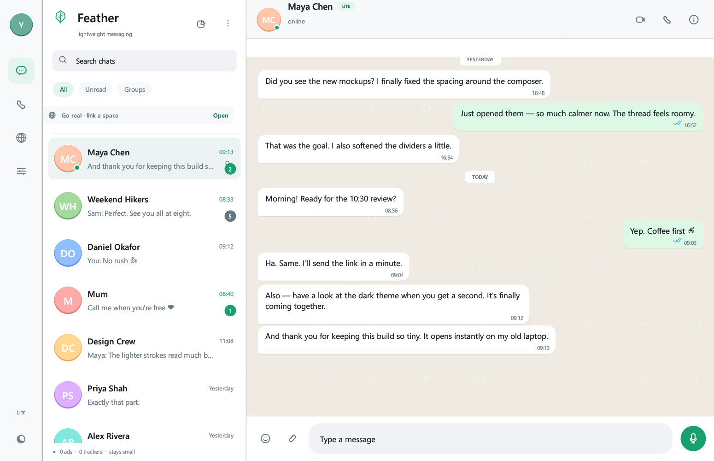

# Feather Chat

A featherweight messenger: a native desktop app (Rust + egui) and a phone-sized
web client, both talking to a tiny hub that you run yourself. No ads, no
tracking, no cloud account.



## Run the desktop app

```
git clone https://github.com/mfadlanabdillah/featherchat
cd featherchat
cargo run --release
```

The first screen shows a few sample chats so the app has something to look at.
Click **Open** on the "Go real" strip, or the globe in the left rail, to create
or join a real space.

## Create a space (host)

1. Open **Feather Link** in the left rail.
2. Choose **Create a space**, enter your name and a PIN, and press
   **Create my space**.
3. The hub starts on port 8777 (or the next free port). The app shows an address
   such as `http://192.168.1.5:8777`.
4. On a phone connected to the same Wi-Fi, open that address in a browser.
   Enter a name and PIN to make an account, then start a chat.

The hub runs while the desktop app is open. To keep it running on an always-on
computer or a server, use the headless program (no window, no drawing code):

```
cargo run --release -p feather-core --bin feather-hub -- --port 8777
```

The data file lives at `%APPDATA%\Feather\hub.json` on Windows (or
`~/.local/share/feather/hub.json` elsewhere). On a server, set
`FEATHER_DATA=/var/lib/feather/hub.json`. Back the file up to keep the history.

## Put it on a VPS

Copy this `app` folder to the server first (from the folder above it):

```bash
scp -r app root@YOUR_SERVER_IP:/opt/feather
```

Then one command on a Debian/Ubuntu server builds the half-megabyte hub, runs
it as a service, adds HTTPS and tells you if anything is wrong:

```bash
cd /opt/feather
sudo bash deploy/install.sh deploy --domain chat.example.com --email you@example.com
bash deploy/install.sh status
```

Then open `https://chat.example.com`. Only ports 80 and 443 are public; the hub
stays on a private port. The same installer handles backups, updates, sign-up
closing and removal, and it has a Docker path (`--mode docker`).

**If an AI assistant is doing the server work, point it at
[AGENTS.md](AGENTS.md)** — that file is written for it, with the preflight
checks, the one command, the failure table and the rollback. A sentence you can
paste to that assistant:

> Read /opt/feather/AGENTS.md and deploy Feather Chat on this server. Ask me for
> the domain name first, then follow the file and tell me what you verified.

The long human guide is [DEPLOY.md](DEPLOY.md).

## Join a space (another computer or phone)

- **Phone:** open the address the host shared. That page is the phone version.
- **Desktop:** Feather Link → **Join a space**, enter the address and your
  name + PIN.
- **Same account on two devices:** use the same name and PIN on both. Chats and
  read state stay in sync through the hub.
- Feather reopens your last space on the next launch. Use **Disconnect** in the
  Link panel to go back to the sample chats.

Use **Add to Home screen** in the phone browser to keep Feather one tap away.
(It is a web app served by your hub, not an app-store download.)

## What travels for real

- Accounts with a name and PIN
- Direct chats and group chats
- Text messages, delivered through the hub
- Typing indicators
- Delivered / read receipts
- Replies and emoji reactions
- Unread counts, search, online dots
- History saved on the hub

The sample chats and the call screens in the desktop app are still a local
demonstration. Linked chats are the real ones.

## About RCS

Carrier RCS is an operator service (it needs a mobile network's messaging
infrastructure and a carrier agreement), so a standalone app cannot place real
RCS messages. Feather instead implements the chat features people associate
with RCS: typing, read receipts, replies, reactions and groups. Photos, voice
notes and real calls are not in linked chats yet.

## Limits worth knowing

- The hub itself speaks plain HTTP. On a VPS, put the supplied Caddy proxy in
  front so phones use HTTPS; the desktop app understands `https://` addresses.
- There is no end-to-end encryption. The server can read messages.
- Phones must be able to reach the hub. On the same Wi-Fi that is automatic; over
  the internet the hub needs a reachable address (the VPS setup).
- Windows may ask to allow Feather through the firewall the first time you host.
- The phone page needs the hub to be awake. There is no push notification or
  offline queue yet.
- The hub keeps the newest 8,000 messages in total. Back up the JSON file.
- Accounts are a name and a PIN; there is no PIN recovery.

## Take a picture of the window

```
cargo run --release -- --screenshot shots/now.png
```

The window opens without taking focus, draws about 120 frames, writes the PNG and
exits. Started without `--screenshot`, it opens normally.
